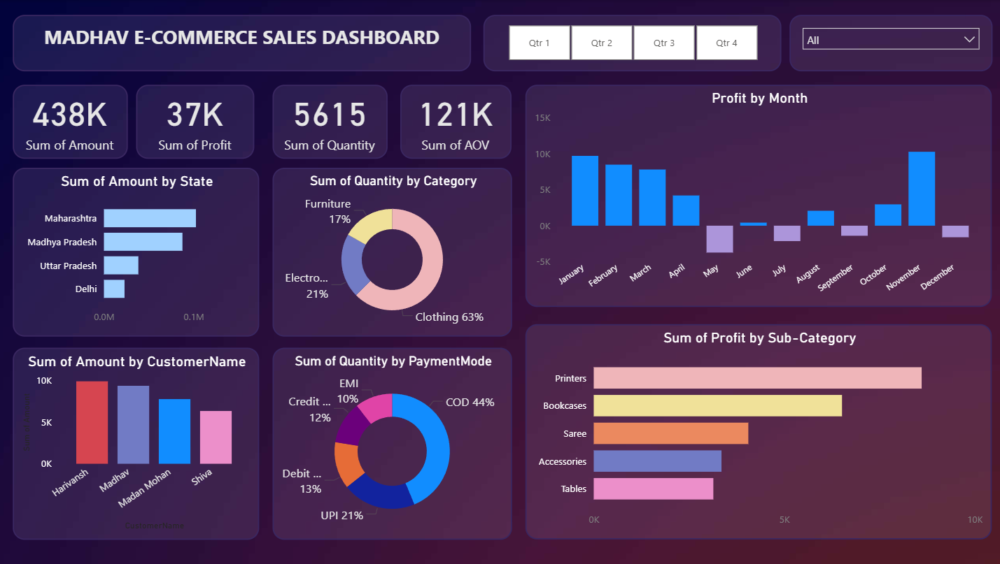

# PBI_Madhav_stores_sales
# Madhav E-Commerce Sales Dashboard | Power BI

## Project Overview
An interactive E-Commerce Sales Dashboard developed using **Microsoft Power BI** to analyze sales performance, profitability, customer behavior, product categories, and payment methods.

## Dashboard Preview

## Key Features
- **Sales Overview:** Total Amount, Profit, Quantity, and Average Order Value (AOV).
- **State-wise Analysis:** Sales distribution across different states.
- **Category Analysis:** Quantity distribution by product category.
- **Monthly Profit Analysis:** Tracks monthly profit and loss trends.
- **Customer Analysis:** Identifies sales contribution by customers.
- **Payment Analysis:** Visualizes transactions by payment mode.
- **Sub-Category Analysis:** Compares profitability across product sub-categories.
- **Interactive Filters:** Quarter-wise and category-based filtering.

## Key Performance Indicators (KPIs)
| Metric | Value |
|---|---:|
| Total Sales Amount | 438K |
| Total Profit | 37K |
| Total Quantity | 5,615 |
| Average Order Value | 121K |

## Tools & Technologies
- Microsoft Power BI
- Power Query
- Data Visualization
- Data Analysis

## Skills Demonstrated
- Data Cleaning and Transformation
- Exploratory Data Analysis (EDA)
- KPI Development
- Interactive Dashboard Design
- Business Intelligence
- Data Visualization

## Project Objective
To transform e-commerce sales data into meaningful visual insights that help understand business performance and support data-driven decision-making.

## Author
**Sayeeda Fathima S**  
B.Tech – Artificial Intelligence & Data Science
